# AWS Infrastructure Lab

A documented AWS infrastructure lab built in **Asia Pacific (Mumbai) – `ap-south-1`**. This report explains the purpose and configuration of each AWS service and places the corresponding screenshot immediately after its explanation.

> **Project scope:** AWS infrastructure creation and validation only. Windows Server role configuration (AD DS, DNS, DHCP, Group Policy, File Services, etc.) is not covered.

## 1. Project Overview

This lab provisions two Windows Server 2025 EC2 instances in a dedicated VPC and subnet. The environment uses an Internet Gateway and route table for internet routing, security groups for traffic control, an EC2 IAM role for Systems Manager, encrypted EBS gp3 volumes, and Fleet Manager for browser-based remote access.

## 2. Architecture

The following diagram summarizes the resource relationships. Both instances share the same VPC, subnet, and Availability Zone. They use private IPv4 addresses for east-west communication.

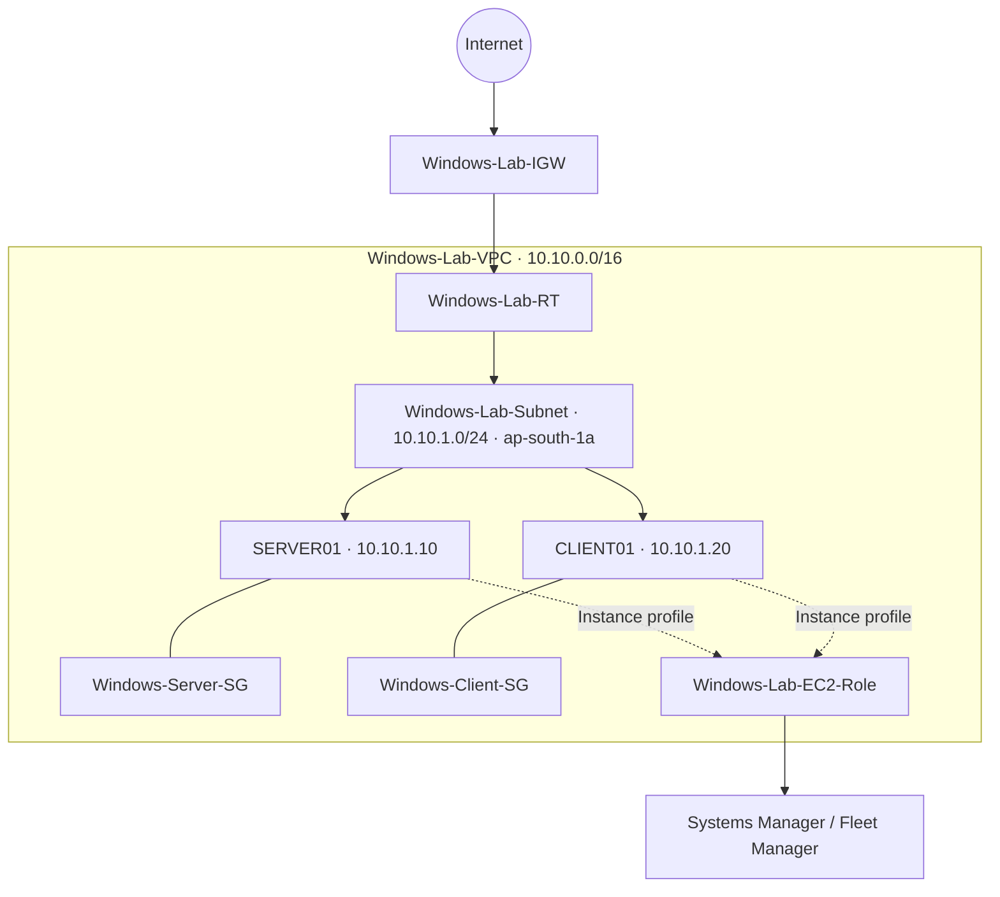

## 3. Resource Summary

| Component | Configuration |
|---|---|
| Region | `ap-south-1` (Mumbai) |
| Monthly budget | $40 |
| VPC | `10.10.0.0/16` |
| Subnet | `10.10.1.0/24`, `ap-south-1a` |
| Internet Gateway | Attached to lab VPC |
| Default route | `0.0.0.0/0` → Internet Gateway |
| SERVER01 | `c7i-flex.large`, private IP `10.10.1.10` |
| CLIENT01 | `c7i-flex.large`, private IP `10.10.1.20` |
| EBS | 40 GiB gp3 per instance, encrypted |
| Systems Manager | Both nodes Online |
| Connectivity | Ping successful in both directions |

## 4. Detailed Service Configuration


### 1. AWS Budget and Cost Management


#### Budget overview

This screenshot shows the `Windows-Lab-Budget` cost budget. The budget is configured for a monthly period with a $40 limit. At the time captured, the console showed $0.00 actual spend and a $0.03 forecast, with the budget health marked healthy. This provides a basic cost-governance baseline for the lab.

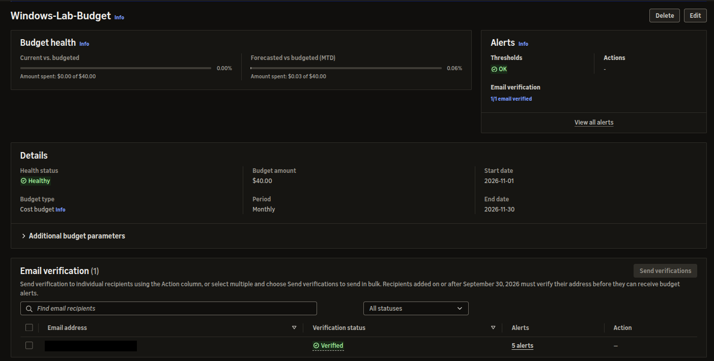


#### Budget alert thresholds

The alert configuration defines actual-cost notifications at 20%, 50%, 75%, and 90% of the $40 budget, plus a forecast-cost alert at 100%. These thresholds provide early warning as spending approaches the project limit. AWS Budgets alerts are notifications; they do not automatically stop resources or enforce a hard spending cap.

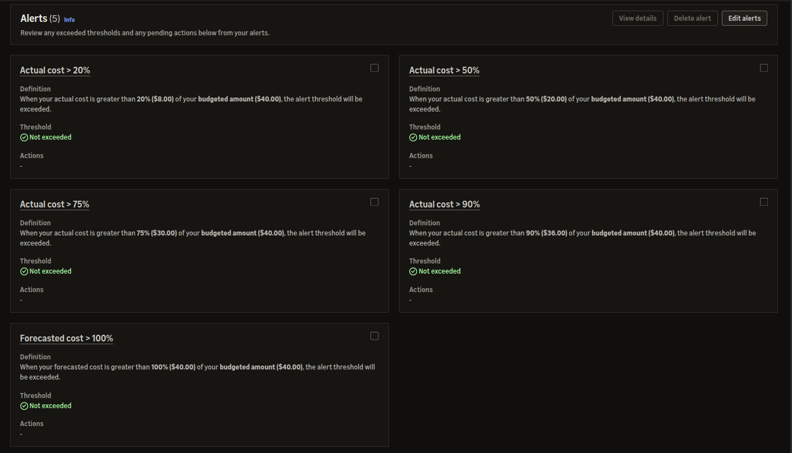


### 2. VPC and Network Architecture


#### VPC configuration

The `Windows-Lab-VPC` is the dedicated virtual network for this environment. Its IPv4 CIDR is `10.10.0.0/16`, and both DNS resolution and DNS hostnames are enabled. The resource map also shows the subnet, route tables, and Internet Gateway associated with this network.

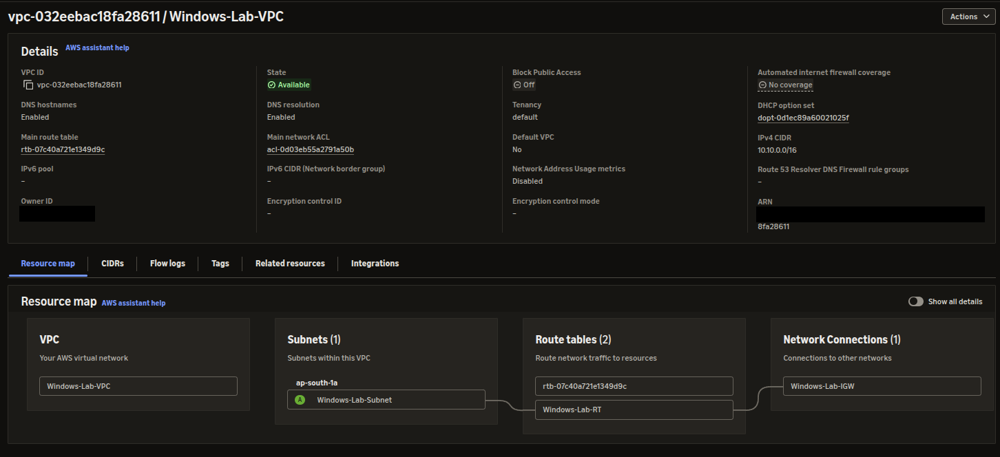


#### Subnet configuration

The `Windows-Lab-Subnet` uses CIDR `10.10.1.0/24` in Availability Zone `ap-south-1a`. Auto-assign public IPv4 is enabled. Both lab EC2 instances are placed in this subnet, while their private addresses are used for communication inside the VPC.

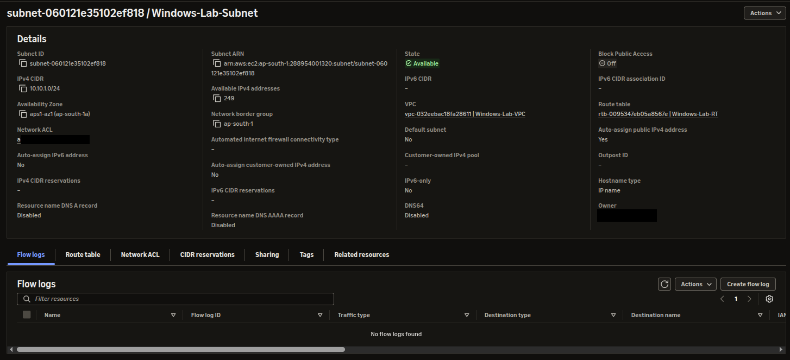


#### Internet Gateway attachment

The `Windows-Lab-IGW` is shown in the attached state and linked to `Windows-Lab-VPC`. An Internet Gateway provides the VPC with a path to and from the internet when routing and instance addressing permit it. Its presence alone does not grant inbound access; security-group rules still control allowed traffic.

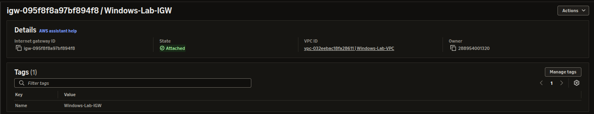


#### Route table routes

The `Windows-Lab-RT` contains two active routes: `10.10.0.0/16` targets the VPC-local route, and `0.0.0.0/0` targets the Internet Gateway. The local route supports communication within the VPC, while the default route directs other IPv4 destinations toward the Internet Gateway.

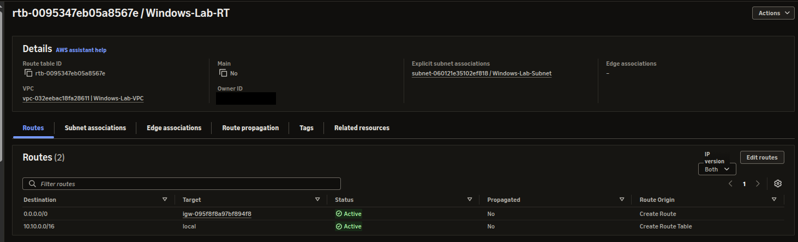


#### Subnet association

This screenshot confirms an explicit association between `Windows-Lab-RT` and `Windows-Lab-Subnet`. Associating the route table ensures that resources launched in this subnet use the routes documented above.

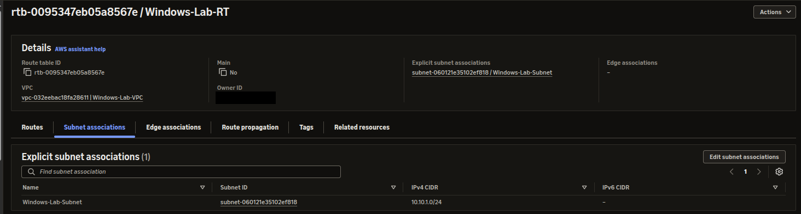


### 3. Security Groups and Traffic Controls


#### SERVER01 security-group inbound rules

The `Windows-Server-SG` inbound rule shown permits RDP over TCP port 3389 only from `10.10.1.20/32`, the private address assigned to CLIENT01. This is narrower than exposing RDP to the public internet. The screenshot is a point-in-time capture; compare it with the successful ping evidence later in this report because the displayed inbound rule set may have changed during troubleshooting.

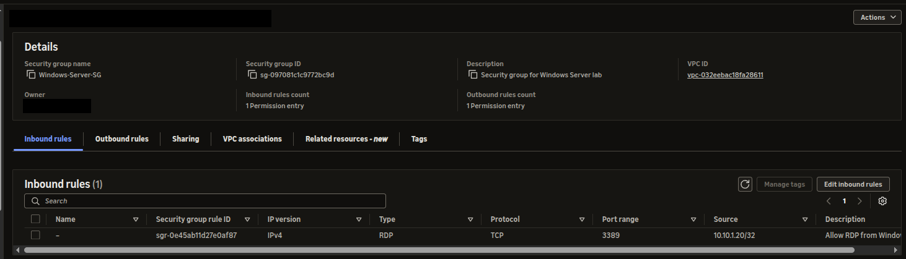


#### SERVER01 security-group outbound rules

The outbound rule shown allows all traffic to `0.0.0.0/0`. This permits the instance to initiate outbound IPv4 connections. For a production environment, outbound access should be restricted to the destinations and protocols required by the workload.

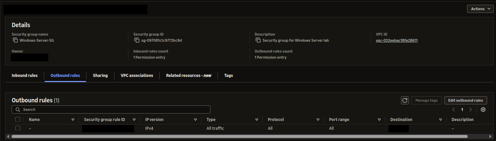


#### CLIENT01 security-group outbound configuration

This capture records the outbound policy for `Windows-Client-SG`. The displayed rule allows all outbound IPv4 traffic to `0.0.0.0/0`, which supports general outbound connectivity but is broader than a least-privilege production policy.

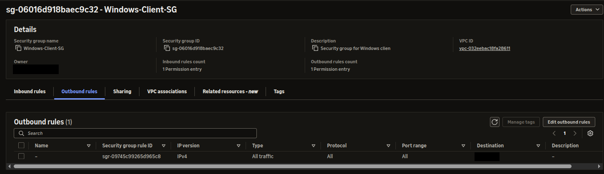


#### CLIENT01 security-group inbound rules

The `Windows-Client-SG` inbound rule allows all ICMP IPv4 traffic from `10.10.1.0/24`. This enables ICMP echo requests from hosts within the lab subnet, subject to the destination instance's own security group and Windows Firewall.

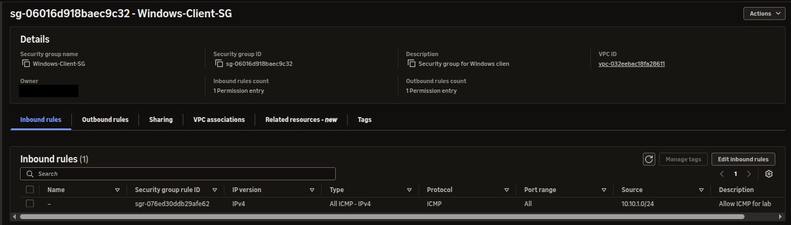


#### CLIENT01 outbound rule details

This screenshot provides the detailed outbound-rule view for the client security group. The destination is `0.0.0.0/0` and the rule permits all traffic. Keep in mind that security groups are stateful, but outbound rules still determine which new outbound flows can be initiated.

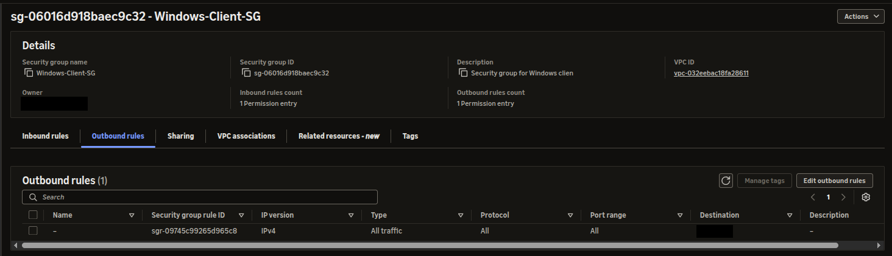


### 4. IAM Role and EC2 Permissions


#### IAM role permissions

The `Windows-Lab-EC2-Role` has the AWS-managed `AmazonSSMManagedInstanceCore` policy attached. This policy provides the core permissions an EC2 managed node needs to communicate with Systems Manager. The role is assigned to both lab instances.

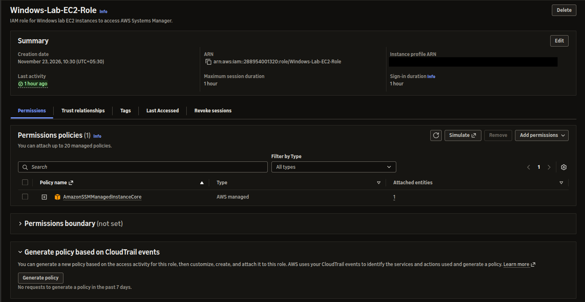


#### IAM trust relationship

The trust policy identifies the EC2 service (`ec2.amazonaws.com`) as the trusted principal and permits `sts:AssumeRole`. This allows EC2 to assume the role through its instance profile so that the instance can use the attached Systems Manager permissions.

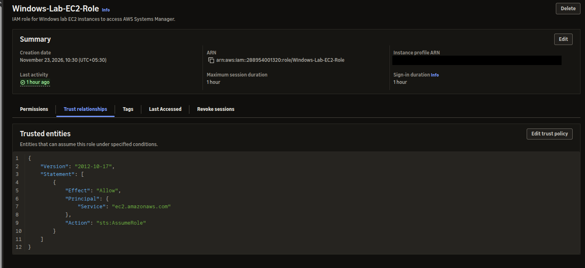


### 5. EC2 Compute Instances


#### SERVER01 instance overview

SERVER01 is a running `c7i-flex.large` EC2 instance using Windows Server 2025 Datacenter. Its private IPv4 address is `10.10.1.10`. The instance is associated with the lab VPC, subnet, key pair, and Systems Manager IAM role. IMDSv2 is marked Required.

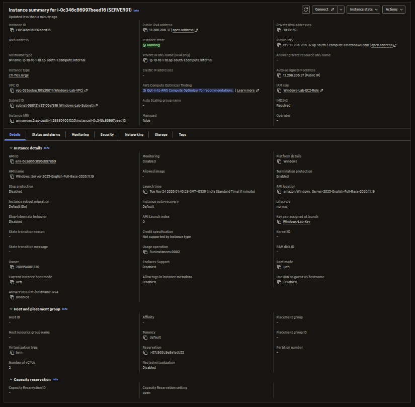


#### SERVER01 network configuration

The networking view confirms SERVER01's VPC and subnet placement, Availability Zone `ap-south-1a`, and private IPv4 address `10.10.1.10`. The instance also has an auto-assigned public IPv4 address, which has been redacted in the evidence image because it is not needed to explain the private lab topology.

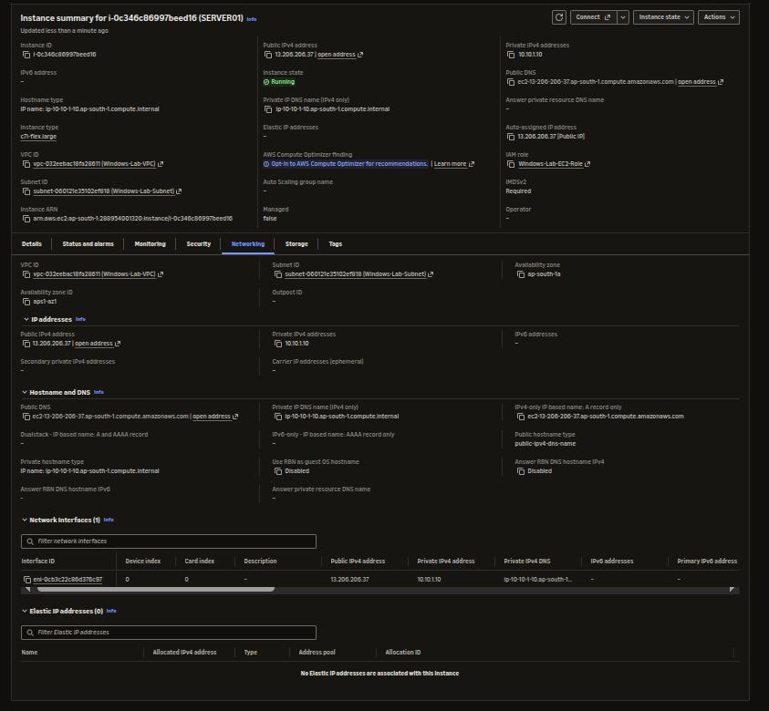


#### SERVER01 security configuration

This view shows the IAM role and the `Windows-Server-SG` attached to SERVER01, along with the inbound and outbound rules visible at capture time. The inbound RDP source is the CLIENT01 private address. Avoid opening RDP to `0.0.0.0/0`; use Systems Manager or tightly scoped administrative access.

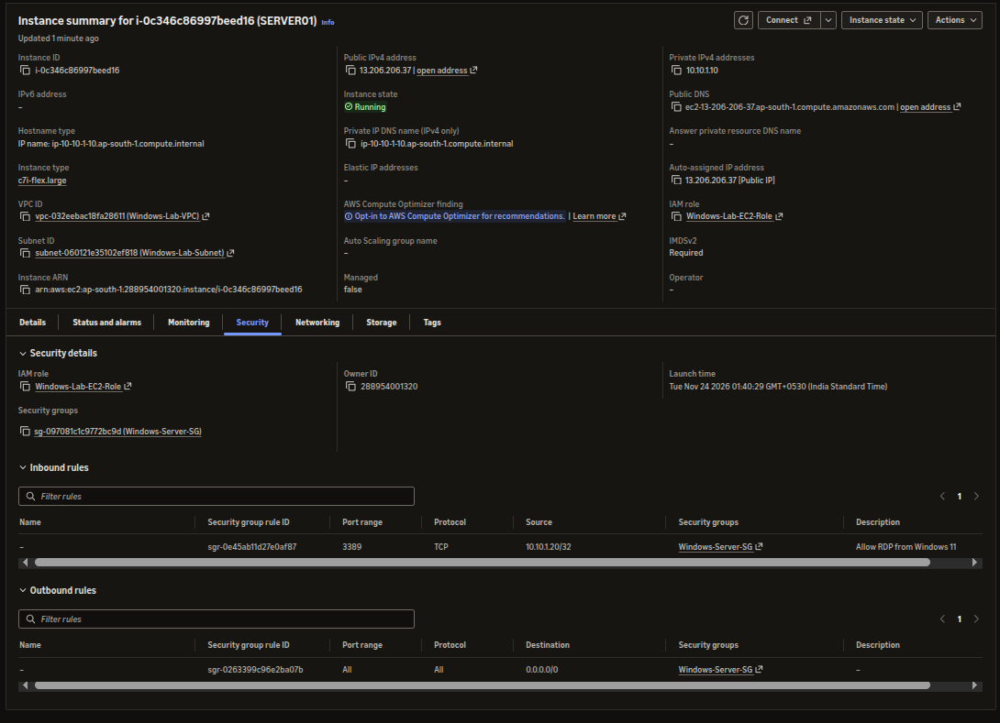


### 6. CLIENT01 Compute Instance


#### CLIENT01 instance overview

CLIENT01 is a running `c7i-flex.large` EC2 instance using Windows Server 2025 Datacenter. Its private IPv4 address is `10.10.1.20`. It shares the lab VPC, subnet, Availability Zone, and IAM role with SERVER01. IMDSv2 is Required.

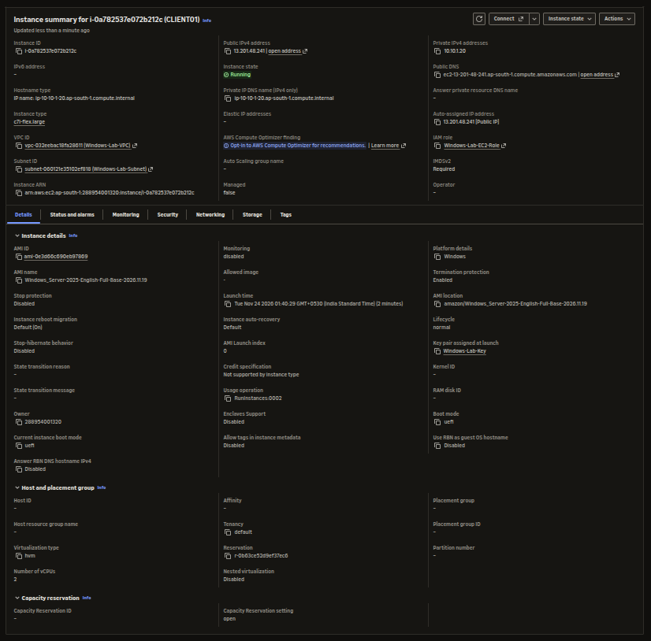


#### CLIENT01 network configuration

The networking view confirms CLIENT01 is connected to `Windows-Lab-VPC` and `Windows-Lab-Subnet` with private IPv4 address `10.10.1.20` in `ap-south-1a`. Its public IPv4 address is redacted in the screenshot.

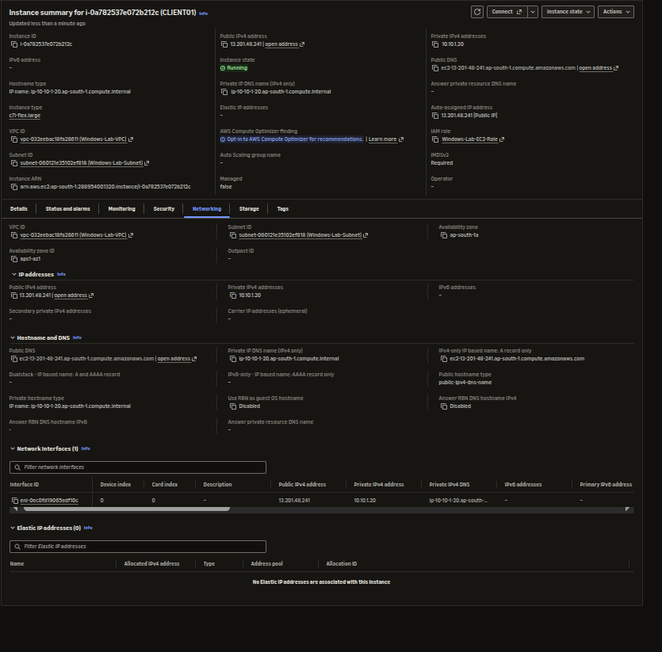


#### CLIENT01 security configuration

This view shows `Windows-Client-SG` attached to CLIENT01. The inbound ICMP rule allows traffic from the lab subnet, and outbound traffic is allowed to `0.0.0.0/0` in the captured configuration.

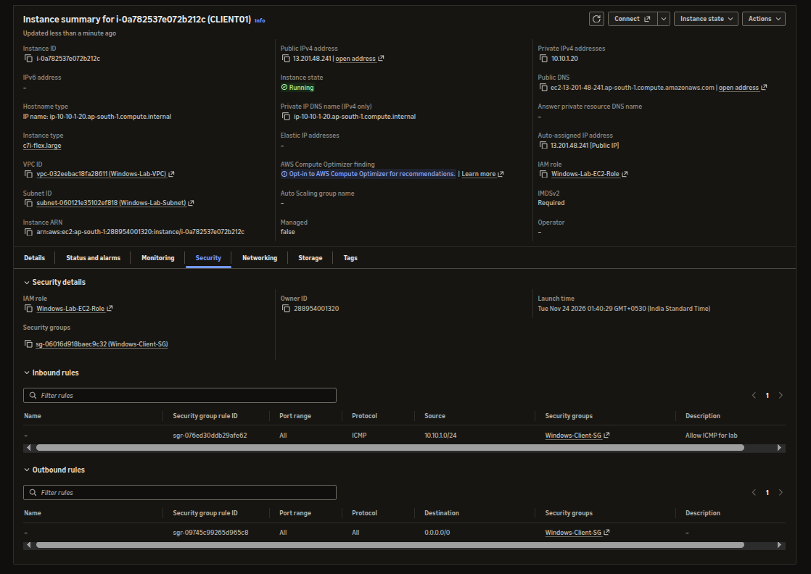


### 7. EBS Block Storage


#### SERVER01 root EBS volume

SERVER01's attached root volume is 40 GiB, General Purpose SSD (`gp3`), configured for 3,000 IOPS and 125 MiB/s throughput. Encryption is enabled using the AWS-managed EBS KMS key alias `aws/ebs`. The console reports the volume as In-use, with status Okay and initialization Completed.

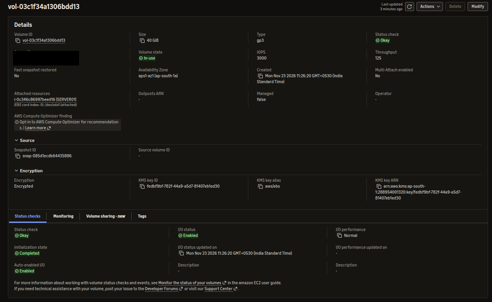


#### CLIENT01 root EBS volume

CLIENT01's attached root volume has the same configuration: 40 GiB `gp3`, 3,000 IOPS, 125 MiB/s throughput, and encryption enabled with the `aws/ebs` KMS key alias. The volume is In-use and its status check is Okay.

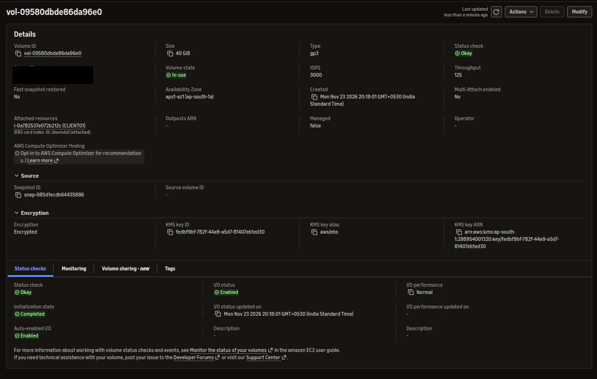


### 8. AWS Systems Manager and Fleet Manager


#### Fleet Manager managed-node inventory

Fleet Manager lists two managed nodes: SERVER01 and CLIENT01. Both are shown Running with Ping status Online and SSM Agent version `3.3.5700.0`. This confirms that the instances are registered as Systems Manager managed nodes and are communicating with the service at the time of capture.

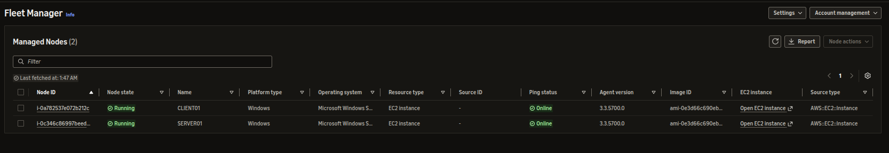


#### CLIENT01 managed-node details

The CLIENT01 node details show Windows as the platform, Windows Server 2025 Datacenter as the operating system, private IP `10.10.1.20`, and Online ping status. The instance is associated with the lab EC2 instance profile.

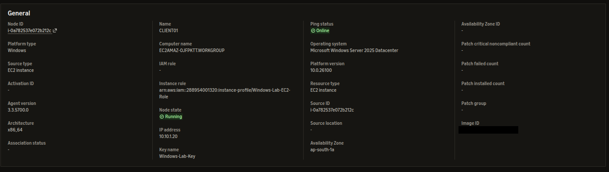


#### SERVER01 managed-node details

The SERVER01 node details show Windows Server 2025 Datacenter, private IP `10.10.1.10`, and Online ping status. The node is associated with the lab EC2 instance profile and reports the SSM Agent version shown in the Fleet Manager inventory.

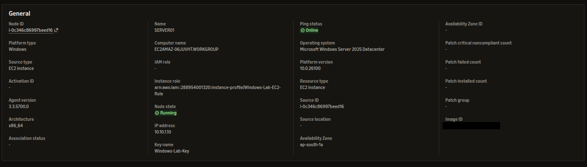


#### SERVER01 browser-based desktop session

This Fleet Manager capture shows the SERVER01 Windows desktop in a browser-based remote session. It demonstrates that the Systems Manager Fleet Manager remote desktop path is working for SERVER01. The public IP overlay has been redacted; the private IP remains visible for topology context.

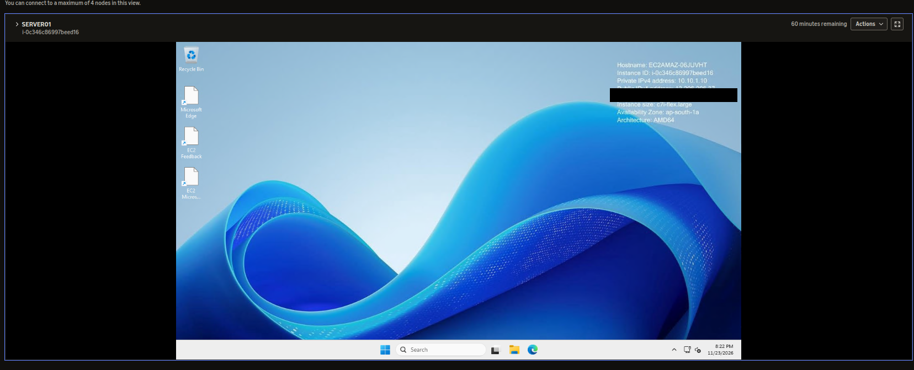


#### CLIENT01 browser-based desktop session

This capture shows the CLIENT01 Windows desktop in a browser-based remote session through Fleet Manager. It demonstrates that browser-based remote access is working for CLIENT01 as well. The public IP overlay has been redacted.

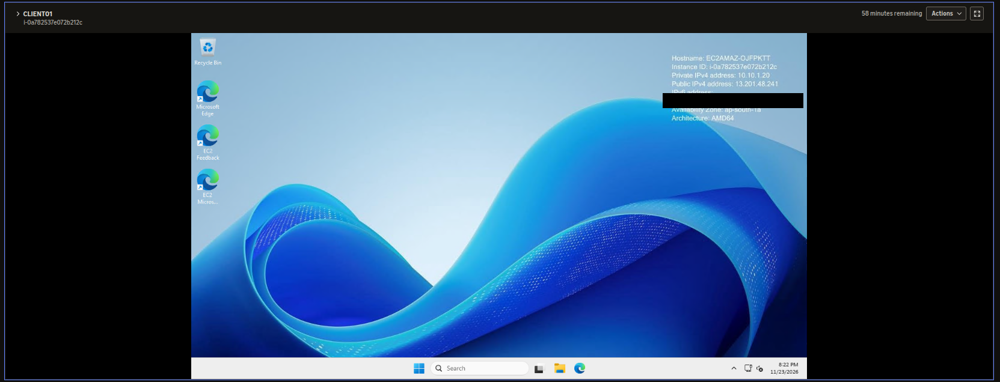


### 9. Private Network Connectivity Validation


#### CLIENT01 to SERVER01 ICMP test

From CLIENT01 (`10.10.1.20`), the command `ping 10.10.1.10` sends four ICMP echo requests to SERVER01. The output shows four replies, zero packet loss, and response times below 1 ms. This confirms private IPv4 reachability in this direction at the time of testing.

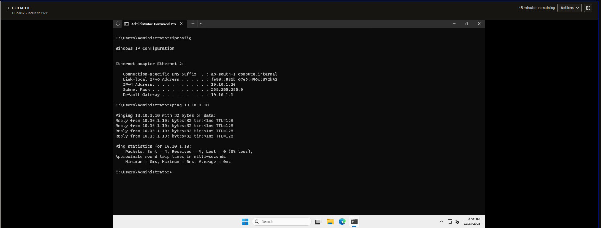


#### SERVER01 to CLIENT01 ICMP test

From SERVER01 (`10.10.1.10`), the command `ping 10.10.1.20` sends four ICMP echo requests to CLIENT01. The output shows four replies, zero packet loss, and response times below 1 ms. Together, the two ping captures demonstrate successful bidirectional private IP connectivity.

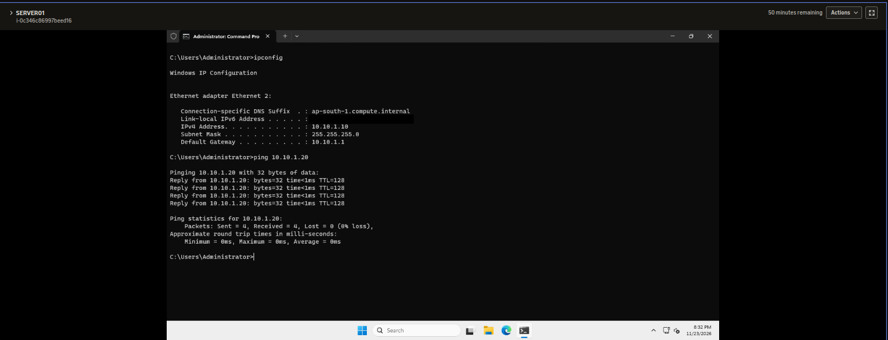


## 5. Key Verification Results

| Verification | Result |
|---|---|
| Budget health | Healthy at capture time |
| VPC DNS resolution and hostnames | Enabled |
| Internet Gateway attachment | Attached |
| Route table association | Explicit subnet association |
| SERVER01 EC2 state | Running |
| CLIENT01 EC2 state | Running |
| EBS encryption | Enabled on both volumes |
| Systems Manager | Both managed nodes Online |
| Fleet Manager desktop | Browser session shown for both instances |
| CLIENT01 → SERVER01 ping | 4/4 replies, 0% loss |
| SERVER01 → CLIENT01 ping | 4/4 replies, 0% loss |

## 6. Security and Operational Notes

- The subnet is configured to auto-assign public IPv4 addresses. Public IPv4 assignment increases exposure and should be considered carefully.
- The screenshots show RDP permitted to SERVER01 from CLIENT01's private address (`10.10.1.20/32`), not from the entire internet.
- The captured security-group outbound rules allow all IPv4 traffic to `0.0.0.0/0`. This is convenient for a lab but broader than a least-privilege production design.
- The server security-group inbound screenshot showed an RDP rule, while the later ping test succeeded. Security-group rules may have changed between captures or another applicable rule may have existed at test time. Review the current rules before reproducing the lab.
- AWS Budgets sends alerts; it does not impose a hard cap or automatically stop EC2 instances.
- Stop EC2 instances when they are not in use. EBS volumes and other provisioned resources can continue to incur charges while instances are stopped.
- Screenshots have been redacted for detected email addresses, account identifiers, and public IPv4 addresses where applicable. Inspect images manually before publishing the repository publicly.

## 7. Repository Structure

```text
aws-infrastructure-lab/
├── README.md
├── docs/
│   ├── budget-and-cost-management.md
│   ├── networking.md
│   ├── security-and-iam.md
│   ├── compute-and-storage.md
│   └── systems-manager-and-validation.md
└── images/
    └── numbered AWS Console and validation screenshots
```

## 8. Disclaimer

This is a learning lab, not a production-ready reference architecture. A production deployment should evaluate private subnet placement, controlled egress, centralized logging, backup and recovery, least-privilege IAM, and resource lifecycle automation.
